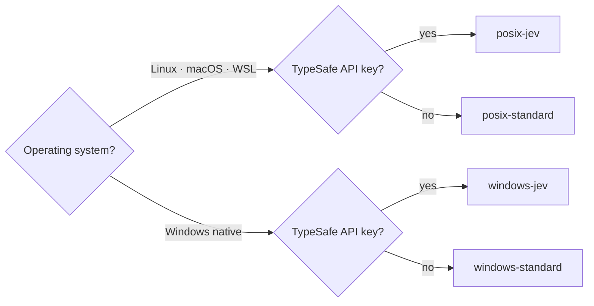
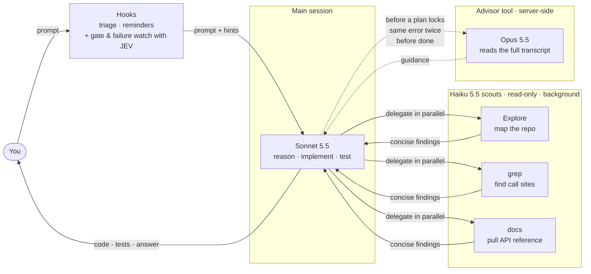
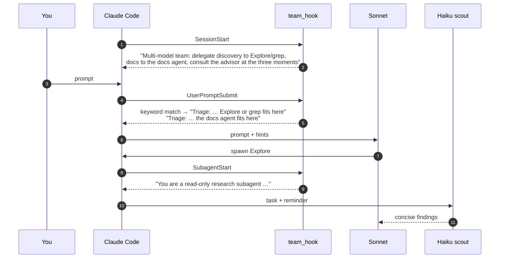
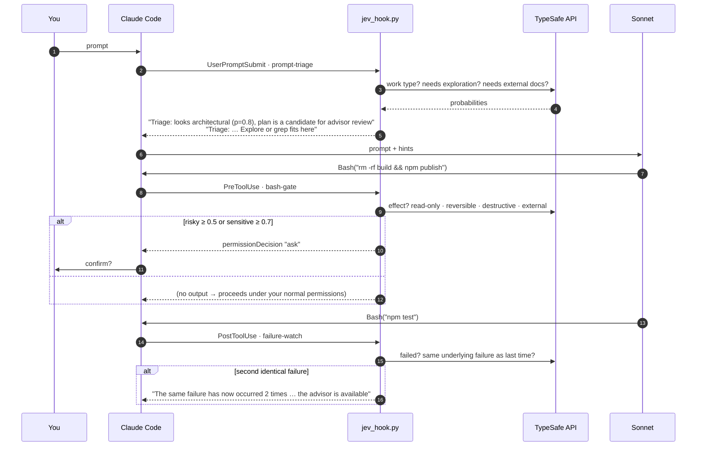

# Claude Code Multi-Model Team

**Run Sonnet, Haiku and Opus together in one Claude Code session, each doing only what it is best at.**

A drop-in `~/.claude` configuration in four ready-to-copy variants (Linux/macOS/WSL or Windows, with or without the JEV decision layer). Copy one folder, start a new session, and Claude Code becomes a small team: a builder, three scouts and an advisor.

| Role | Model | Where it runs | What it does |
| - | - | - | - |
| **Builder** | Sonnet 5.5 | Main session | Reasons, plans, writes and edits code, runs tests |
| **Scouts** | Haiku 5.5 | Three read-only subagents | Map the repo, find call sites, pull API docs, in parallel and in the background |
| **Advisor** | Opus 5.5 | Server-side advisor tool | Reads the full transcript and advises at decision points only |

Everything here follows the official Claude Code docs for the [advisor tool](https://code.claude.com/docs/en/advisor), [subagents](https://code.claude.com/docs/en/sub-agents), [hooks](https://code.claude.com/docs/en/hooks) and [code-intelligence plugins](https://code.claude.com/docs/en/plugins/code-intelligence).

---

## Contents

- [Why this matters](#why-this-matters)
- [What is in this repository](#what-is-in-this-repository)
- [Installation](#installation)
- [How it works](#how-it-works)
  - [The team](#the-team)
  - [What is LSP and why we need it](#what-is-lsp-and-why-we-need-it)
  - [Standard variants](#standard-variants-offline-hooks)
  - [JEV variants](#jev-variants-classifier-hooks)
- [Tuning](#tuning)
- [Verification checklist](#verification-checklist)
- [Known limitations](#known-limitations)
- [Uninstall](#uninstall)

---

## Why this matters

Running a single model for everything forces a bad trade: Opus everywhere is expensive and slow on the 80 % of turns that are routine, while Sonnet everywhere leaves you without a strong second opinion exactly when a plan is about to go wrong. Reading hundreds of files to map a repository burns the same tokens whichever model does it.

This setup splits the work by what each model is good at:

- **Cost lands where it is earned.** Opus reads the conversation only when the builder escalates, not on every turn. Haiku does the high-volume file reading at a fraction of the price. Sonnet does the actual engineering.
- **An independent reviewer.** The advisor sees every tool call and result, so it catches a plan that is about to fail without being anchored on the builder's own reasoning. It is consulted before a plan locks, when the same error hits twice, and before work is declared done.
- **Parallel discovery.** The three scouts run as background subagents, so repository mapping, symbol lookup and documentation research happen at the same time, and only concise findings come back into the main context.
- **The builder's context stays clean.** Scouts return paths, symbols and summaries, not file dumps. The main session keeps its context for reasoning and code.

The optional **JEV layer** takes this one step further down: the micro-decisions that need no large model at all ("does this prompt need repository discovery?", "is this shell command destructive?", "is this the same test failure as last time?") are answered by a fast classifier inside Claude Code hooks, and the result is handed to the builder as a one-line fact. Colleagues without a JEV key get the same nudges from a tiny offline keyword hook instead.

---

## What is in this repository

```
.
├── README.md
├── .gitignore                     Keeps API keys and JEV logs out of the repo
├── posix-jev/                     Linux · macOS · WSL, with JEV
├── posix-standard/                Linux · macOS · WSL, offline hooks
├── windows-jev/                   Windows native, with JEV
└── windows-standard/              Windows native, offline hooks
```

Each variant mirrors the layout of `~/.claude/` (`%USERPROFILE%\.claude` on Windows), so installation is a copy:

```
<variant>/
├── CLAUDE.md                      Orchestration rules the main session follows
├── settings.json                  Model, advisor, env and hook wiring
├── agents/
│   ├── Explore.md                 Haiku · maps repository structure (overrides the built-in Explore)
│   ├── grep.md                    Haiku · definitions, references, call sites
│   └── docs.md                    Haiku · official docs and API references
├── hooks/
│   ├── jev_hook.py                -jev only: JEV decision layer (uv script, fails open)
│   └── team_hook.sh | .ps1        -standard only: offline reminders + keyword triage (fails open)
└── jev.api_key.example            -jev only: placeholder for the TypeSafe API key
```

### Choosing a variant

|  | **With JEV** | **Standard** |
| - | - | - |
| **Linux / macOS / WSL** | `posix-jev/` | `posix-standard/` |
| **Windows (native)** | `windows-jev/` | `windows-standard/` |



### What differs between variants

| | posix-jev | posix-standard | windows-jev | windows-standard |
| - | - | - | - | - |
| Builder · scouts · advisor | ✔ | ✔ | ✔ | ✔ |
| Prompt triage | JEV classifier | keyword hook, offline | JEV classifier | keyword hook, offline |
| Shell-command gate | JEV (`ask` only) | — | JEV (`ask` only) | — |
| Repeated-failure watch | JEV | — | JEV | — |
| Session / subagent reminders | — | ✔ | — | ✔ |
| Hook runtime | bash, 5 s timeout | bash, 5 s | PowerShell (`shell: "powershell"`), matcher `Bash\|PowerShell`, 10 s | PowerShell `-NoProfile -ExecutionPolicy Bypass`, 10 s |
| `env.JEV_MODE` | `enforce` | — | `enforce` | — |
| Hook script | `jev_hook.py` | `team_hook.sh` | `jev_hook.py` + UTF‑8 stdio fix, PowerShell commands in skip list | `team_hook.ps1` |
| `CLAUDE.md` | full | *Triage hints* reworded for the keyword hook | full | reworded |
| `agents/` | identical in all four | | | |

---

## Installation

### Prerequisites

| Requirement | Why | Check |
| - | - | - |
| **Claude Code ≥ 2.1.300** | Haiku 5.5 subagents need ≥ 2.1.293; `/advisor` outside the terminal picker needs ≥ 2.1.260 | `claude --version`, then `claude update` |
| **Anthropic API or Claude subscription** | The advisor is a server tool. It is **not** available on Bedrock, Vertex / Agent Platform or Foundry | — |
| **[uv](https://docs.astral.sh/uv/)** (`-jev` only) | `jev_hook.py` is a self-contained `uv run --script`; it fetches `typesafe-sdk` itself | `uv --version` |
| **TypeSafe API key** (`-jev` only) | Powers JEV. Without it the hooks silently do nothing | — |
| **Git for Windows** (Windows, recommended) | Gives Claude Code the Bash tool. Without it Claude uses the PowerShell tool; the `windows-jev` hooks cover both | `bash --version` in PowerShell |
| **.NET SDK / Node.js** (optional) | Only for the language-server plugins in step 5 | `dotnet --version`, `npm --version` |

> **Do not set** `DISABLE_TELEMETRY`, `DO_NOT_TRACK`, `DISABLE_GROWTHBOOK` or `CLAUDE_CODE_DISABLE_NONESSENTIAL_TRAFFIC` to *any* value, even `0`. They turn off feature-flag fetching and the advisor silently stays off. `CLAUDE_CODE_ENABLE_TELEMETRY=0`, which this configuration sets, is fine.

### 1. Back up your current configuration

```bash
# Linux / macOS
cp -r ~/.claude ~/.claude.bak-$(date +%Y%m%d)
```
```powershell
# Windows
Copy-Item "$env:USERPROFILE\.claude" "$env:USERPROFILE\.claude.bak-$(Get-Date -Format yyyyMMdd)" -Recurse
```

### 2. Copy your variant

Replace `<variant>` with the folder you picked.

```bash
# Linux / macOS
cp -r <variant>/CLAUDE.md <variant>/agents <variant>/hooks ~/.claude/
chmod +x ~/.claude/hooks/*
```
```powershell
# Windows
New-Item -ItemType Directory -Force "$env:USERPROFILE\.claude" | Out-Null
Copy-Item <variant>\CLAUDE.md, <variant>\agents, <variant>\hooks "$env:USERPROFILE\.claude\" -Recurse -Force
```

**`settings.json`**: if you don't have one, copy `<variant>/settings.json` as is. If you already have one, merge these keys into it (take the `hooks` block from your variant; `JEV_MODE` exists only in `-jev`):

```jsonc
{
  "model": "sonnet",                 // builder
  "advisorModel": "opus",            // advisor; must rank at or above the main model
  "modelSettings": { "claude-sonnet-5-5": { "effortLevel": "medium" } },
  "env": {
    "CLAUDE_CODE_ENABLE_TELEMETRY": "0",
    "JEV_MODE": "enforce"            // -jev only; "shadow" = log, never act
  },
  "hooks": { /* copy from <variant>/settings.json */ }
}
```

### 3. Add the TypeSafe key (`-jev` variants only)

```bash
# Linux / macOS
mkdir -p ~/.claude/jev && chmod 700 ~/.claude/jev
echo "YOUR_KEY" > ~/.claude/jev/api_key && chmod 600 ~/.claude/jev/api_key
```
```powershell
# Windows
New-Item -ItemType Directory -Force "$env:USERPROFILE\.claude\jev" | Out-Null
Set-Content -NoNewline -Path "$env:USERPROFILE\.claude\jev\api_key" -Value "YOUR_KEY"
```

Or set `TYPESAFE_API_KEY` in your environment. Install `uv` if needed: `curl -LsSf https://astral.sh/uv/install.sh | sh` (Linux/macOS) or `irm https://astral.sh/uv/install.ps1 | iex` (Windows).

### 4. Start a new session

Open a terminal and run `claude`. The banner should read `Advisor Tool (experimental) is on and may use more tokens · /advisor`. Then go through the [verification checklist](#verification-checklist).

### 5. Code-intelligence plugins (optional, recommended)

The scouts list `LSP` in their tools. It only does something once a language-server **binary** and its **plugin** are installed.

```bash
# binaries — pick the languages you use
dotnet tool install -g csharp-ls                          # C#
npm i -g typescript typescript-language-server           # TypeScript / JavaScript
npm i -g pyright                                          # Python

# plugins — use the git marketplace, NOT the built-in "anthropic-plugin-directory"
claude plugin marketplace add anthropics/claude-plugins-official
claude plugin install csharp-lsp@claude-plugins-official
claude plugin install typescript-lsp@claude-plugins-official
claude plugin install pyright-lsp@claude-plugins-official

# each should report "LSP servers (1)"
claude plugin details csharp-lsp@claude-plugins-official
```

> **Gotcha:** installing the same plugins from the built-in `anthropic-plugin-directory` fetches only README + LICENSE and registers **0** LSP servers, because the server definitions live in the git marketplace manifest. If you already did that, re-run the installs above with `--replace`.

Official plugins also exist for Go, Rust, Java, Kotlin, PHP, Ruby, Swift, Lua and C/C++.

---

## How it works

### The team



**The builder.** Sonnet 5.5 runs the session at `medium` effort. `CLAUDE.md` tells it to delegate discovery, when to consult the advisor, and that it owns the final decision.

**The scouts.** All three agents share the same frontmatter:

```yaml
model: haiku          # Haiku 5.5
effort: low
background: true      # run in parallel, never block the main session
omitClaudeMd: true    # start without CLAUDE.md to stay cheap and fast
maxTurns: 25          # hard cost ceiling
tools: Read, Grep, Glob, LSP   # read-only; Write and Edit are not available
```

Because the custom `Explore.md` has the same name as the built-in Explore agent, it **replaces** it (user-level agents outrank built-ins). Scouts don't read `CLAUDE.md`, so any rule that matters to them ("ignore `vendor/`") must be restated in the delegation prompt; `CLAUDE.md` tells the builder to do exactly that. Scouts inherit the advisor but are instructed never to call it.

**The advisor.** Claude decides when to call it; there is no setting to force or cap calls. `CLAUDE.md` nudges it toward three moments: before committing to a non-trivial plan, when the same error occurs twice, and before declaring substantial work complete. Each call sends the **entire transcript** to Opus with no caching between calls, so advisor cost grows with session length. Toggling `/advisor` mid-session does **not** invalidate the builder's prompt cache. In the transcript you see `Advising opus…` followed by `Reviewed`, `Declined` or `Unavailable`; press `Ctrl+O` to read the guidance.

### What is LSP and why we need it

**LSP** is the [Language Server Protocol](https://microsoft.github.io/language-server-protocol/), the same protocol your editor uses for "go to definition", "find all references" and rename. A *language server* (`csharp-ls`, `typescript-language-server`, `pyright`, …) parses your project the way the compiler does and answers precise questions about symbols.

Without it, the scouts can only search text with `Grep`. That is fast, but it can't tell apart:

- two functions with the same name in different modules,
- a real call site and a mention in a comment or string,
- a symbol that is re-exported or aliased under another name.

With an LSP server, `grep` and `Explore` can ask for the actual definition, the actual references and the type of a symbol. They return fewer, more accurate hits, so Haiku burns fewer turns and the builder gets cleaner findings with less noise in its context.

The scouts list `LSP` in their `tools`, but the tool only does something once a language-server binary **and** its Claude Code plugin are installed. See [step 5 of the installation](#5-code-intelligence-plugins-optional-recommended). It is optional: without it, the scouts fall back to text search.

### Standard variants: offline hooks

The standard variants keep the whole team and add a tiny script, `team_hook.sh` (bash) or `team_hook.ps1` (PowerShell), with no network access and no dependencies. It is wired to three hook events:



| Event | Injected as | Content |
| - | - | - |
| `SessionStart` (startup, resume, clear, compact) | plain stdout → context | One paragraph: you are the main session of a multi-model team; delegate; when to consult the advisor |
| `UserPromptSubmit` | `additionalContext` | Up to two `Triage:` lines. Discovery words (`where`, `find`, `implemented`, `call sites`, `references`, …) → Explore/grep hint. Library words (`library`, `api`, `sdk`, `docs`, `version`, `deprecated`, …) → docs hint. Prompts under 80 characters get nothing |
| `SubagentStart` (`*`) | `additionalContext` | You are a read-only scout; return paths, symbols and concise findings; don't modify files, don't decide architecture, don't consult the advisor |

Everything fails open: no match, an error or a timeout simply means no output and Claude Code behaves normally.

### JEV variants: classifier hooks

The `-jev` variants replace the keyword script with `jev_hook.py`, which asks a fast typed classifier (the TypeSafe *system one* API) three kinds of question and turns the probabilities into hints or a permission prompt.



| Hook | Event | Question to the classifier | Effect |
| - | - | - | - |
| `prompt-triage` | `UserPromptSubmit` | Is this mechanical / routine / complex / architectural? Needs repository discovery? Depends on an external library? Is the message trying to steer its own classification? | `Triage:` hints. Escalation threshold is low (p ≥ 0.6), de-escalation high (p ≥ 0.85 and no steering): escalating is cheap to get wrong, de-escalating is not |
| `bash-gate` | `PreToolUse` on `Bash` (and `PowerShell` on Windows) | Is the command read-only, locally reversible, destructive or external? Does it touch production, credentials, permissions or billing? | `permissionDecision: "ask"` when risky. It can **only ask, never allow**, so it cannot weaken your permission rules |
| `failure-watch` | `PostToolUse` / `PostToolUseFailure` | Does the output show a failure? Is it the same underlying failure as the previous one, ignoring line numbers and timestamps? | Deterministic counter per session; at two identical failures in a row it reminds the builder that the advisor is available |

Design properties worth knowing:

- **Fail open.** Any error, a 5 s timeout (10 s on Windows) or a missing key → no output → Claude Code's normal behaviour.
- **Redaction.** Prompts and commands are regex-redacted for API keys, tokens and passwords, then truncated to 4 000 characters before leaving the machine. Review `SECRET` in `jev_hook.py` if your secrets look different.
- **Trivial commands never leave the machine.** `ls`, `cat`, `git status`, … without pipes, redirects or chaining skip the API entirely.
- **Shadow mode.** `JEV_MODE=shadow` logs every decision to `~/.claude/jev/decisions.jsonl` without acting. Run it for a few days to tune thresholds before switching to `enforce`.
- **Latency.** A classifier round-trip measured at roughly half a second on Linux; PowerShell start-up adds a few hundred milliseconds on Windows.

---

## Tuning

| Knob | Where | Default | Notes |
| - | - | - | - |
| Builder model | `settings.json` → `model` | `sonnet` | `opusplan` uses Opus in plan mode and Sonnet to execute |
| Advisor model | `settings.json` → `advisorModel` | `opus` | Must rank at or above the main model. `fable` needs Fable access |
| Builder effort | `modelSettings.claude-sonnet-5-5.effortLevel` | `medium` | `low` … `max` |
| Scout effort / turns | `agents/*.md` frontmatter | `low` / `25` | Raise `maxTurns` for very large monorepos |
| Keyword triage | `hooks/team_hook.sh` / `.ps1` | two regexes | Add your domain's words; keep the 80-character floor |
| JEV mode | `env.JEV_MODE` | `enforce` | `shadow` to observe only |
| JEV thresholds | `hooks/jev_hook.py` | risky ≥ 0.5, sensitive ≥ 0.7, same ≥ 0.8 | Asymmetric on purpose |
| Advisor off | `/advisor off` or `CLAUDE_CODE_DISABLE_ADVISOR_TOOL=1` | — | Toggling keeps the prompt cache |

---

## Verification checklist

Run these in a **new** terminal session after installing.

- [ ] Banner shows `Advisor Tool (experimental) is on and may use more tokens · /advisor`
- [ ] `/model` shows **Sonnet 5.5**; `/advisor` prints **opus**
- [ ] Standard variants: the session starts with a `Multi-model team: …` reminder in context
- [ ] Ask something vague, e.g. *"find where retries are handled"*: a `Triage:` hint appears and an `Explore` or `grep` subagent is spawned in the background
- [ ] With LSP plugins: ask `grep` for the references of a symbol; the collapsed tool row shows `LSP`, not only `Grep`
- [ ] Make a test fail twice in a row: `-jev` variants show `The same failure has now occurred 2 times`; in all variants an `Advising opus…` → `Reviewed` line should follow. Press `Ctrl+O` to read the advice
- [ ] `-jev` variants: `~/.claude/jev/decisions.jsonl` is growing

---

## Known limitations

- **VS Code extension rendering.** The Claude Code VS Code extension (≤ 2.1.300) has no renderer for advisor results and shows `Unsupported content type: advisor_tool_result`. The advisor still runs and its guidance still reaches the builder; read it in the terminal with `Ctrl+O`. Only an extension update can fix this.
- **Advisor timing is not rule-based.** `CLAUDE.md` and the hints make the three moments likely, not guaranteed. There is no setting to force or cap advisor calls.
- **JEV sends data out.** Redacted prompts and shell commands go to the TypeSafe API, in shadow mode too. Use a standard variant on codebases where that is not acceptable.
- **Extra permission prompts with JEV.** In `enforce` mode `bash-gate` adds `ask` prompts for commands it scores as destructive or external. Expect a few more confirmations until you tune the thresholds.
- **Hooks can't pick tools.** Both hook flavours can hint, gate and add context; neither can choose which tool Claude calls.
- **Windows hooks run in PowerShell.** Both Windows variants pin PowerShell so they work with or without Git Bash. Anything your PowerShell profile prints to stdout breaks the hook's JSON output; `windows-standard` passes `-NoProfile` for that reason, `windows-jev` relies on a quiet profile or on switching the hooks to `"shell": "bash"` once Git for Windows is installed.
- **The PowerShell scripts were written on Linux.** They are straightforward, but run `powershell -NoProfile -File team_hook.ps1 session` once on a Windows machine before trusting them.

---

## Uninstall

```bash
# Linux / macOS — full rollback
rm -rf ~/.claude && mv ~/.claude.bak-YYYYMMDD ~/.claude
```
```powershell
# Windows — full rollback
Remove-Item "$env:USERPROFILE\.claude" -Recurse -Force
Rename-Item "$env:USERPROFILE\.claude.bak-YYYYMMDD" ".claude"
```

Or selectively: remove the `hooks` entries and `env.JEV_MODE` from `settings.json`, delete `hooks/` and `agents/{Explore,grep,docs}.md` under your `.claude` folder, and run `/advisor off`.

---

## Credits

Inspired by Anthropic's [advisor strategy](https://claude.com/blog/the-advisor-strategy) and the `claude --model sonnet --advisor opus` pattern. Every setting in this repository was then checked against the official Claude Code documentation.
